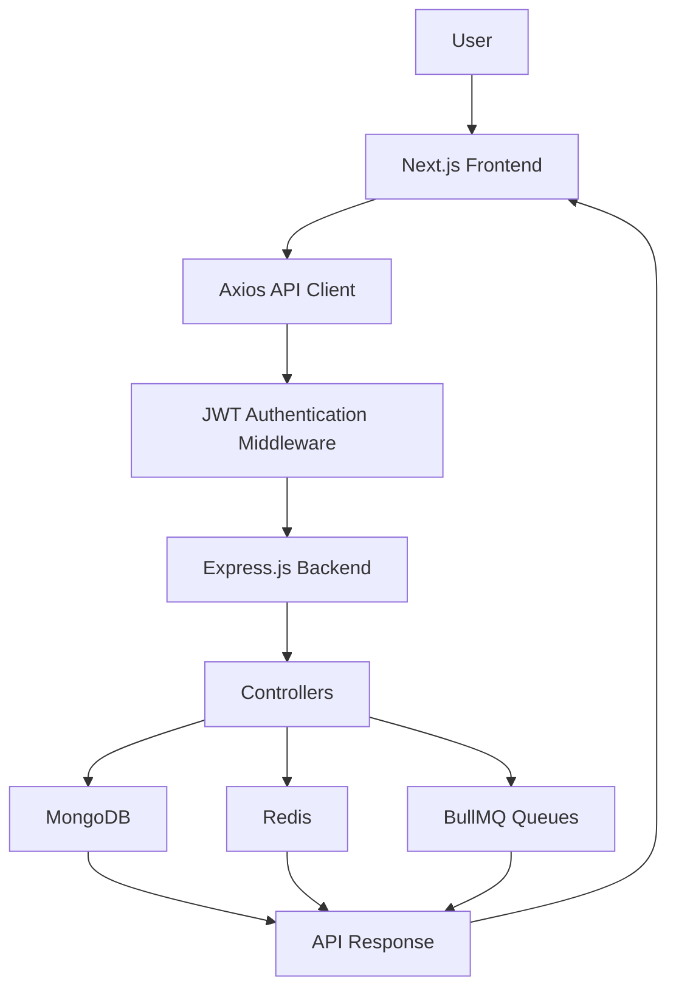

# RedSun — AI Operating System for Teams

<p align="center">
  <strong>An intelligent workspace to manage teams, projects, tasks, and collaboration — all in one place.</strong>
</p>

<p align="center">
  Built with Next.js, React, TypeScript, Node.js, Express.js, MongoDB, and Redis.
</p>

---

## About the Project

**RedSun** is an AI-powered operating system for teams designed to simplify team collaboration, project management, and task organization.

It aims to bring essential team workflows into one centralized platform where managers and team members can organize work, manage projects, track tasks, and stay connected.

The goal is to evolve beyond traditional project management tools by introducing intelligent, AI-driven assistance that helps teams work smarter, make better decisions, and improve productivity.

## Key Features

### Authentication & Security
- User registration and login.
- JWT-based authentication.
- Password hashing using bcrypt.
- Protected backend APIs using authentication middleware.
- Centralized API request and response handling using Axios interceptors.
- Request validation using Joi.
- Security middleware using Helmet and CORS.

### Team Management
- Create and manage teams.
- Retrieve teams associated with users.
- View individual team details.
- Add employees or members to teams.
- Update team information.
- Remove team members.
- Delete teams.

### Project Management
- Organize work through projects.
- Manage project information.
- Connect projects with teams.
- Track project progress.

### Task Management
- Create and organize tasks.
- Assign tasks to team members.
- Manage task progress and status.
- Keep work organized across projects.

### Notifications & Collaboration
- Centralized notifications.
- Team-focused collaboration workflows.
- A unified workspace for managing activities.

### Backend Infrastructure
- MongoDB and Mongoose for database management.
- Redis for caching and supporting background workflows.
- BullMQ for queue-based background processing.
- Express middleware for authentication and request handling.
- Joi for request validation.

### AI-Powered Vision
Planned intelligent capabilities include:
- AI-assisted task management.
- Intelligent team productivity insights.
- Automated workflow assistance.
- AI-powered project summaries.
- Smart recommendations for team collaboration.

*AI capabilities are part of the project's development vision and will be introduced as the platform evolves.*

---

## Technology Stack

| Category | Technologies |
|---|---|
| Frontend | Next.js, React.js, TypeScript |
| Styling | CSS, Tailwind CSS |
| Backend | Node.js, Express.js |
| Database | MongoDB, Mongoose |
| Authentication | JWT, bcrypt |
| API Integration | Axios |
| Caching | Redis |
| Background Jobs | BullMQ |
| Validation | Joi |
| Security | Helmet, CORS, express-rate-limit |
| Version Control | Git, GitHub |

---

## Project Architecture

RedSun follows a frontend-backend architecture.

```text
RedSun/
│
├── frontend/
│   └── my-app/
│       ├── app/
│       ├── components/
│       ├── lib/
│       │   └── axios.ts
│       ├── public/
│       ├── .env.local
│       └── package.json
│
└── backend/
    ├── config/
    ├── controllers/
    ├── model/
    ├── middleware/
    ├── router/
    ├── validation/
    ├── queues/
    ├── workers/
    ├── .env
    ├── package.json
    └── server.js
```

*The structure above is a simplified overview. Adjust folder names if your repository structure differs.*

## Application Workflow



---

## Getting Started

Follow these instructions to run RedSun locally.

### Prerequisites

Make sure you have installed:

- Node.js and npm.
- MongoDB or MongoDB Atlas.
- Redis.
- Git.

### 1. Clone the Repository

```bash
git clone <YOUR_GITHUB_REPOSITORY_URL>
```

```bash
cd AI-Operating-System-for-Teams
```

### 2. Backend Setup

Navigate to the backend directory:

```bash
cd backend
```

Install dependencies:

```bash
npm install
```

Create a `.env` file in the backend directory.

Configure your environment variables according to your backend configuration:

```env
PORT=1000
ATLASDB_URL=your_mongodb_connection_string
JWT_SECRET=your_jwt_secret
REDIS_URL=your_redis_connection_url
```

*Use the exact environment variable names expected by your backend configuration.*

Start the backend:

```bash
npm run dev
```

### 3. Frontend Setup

Open another terminal and navigate to the frontend:

```bash
cd frontend/my-app
```

Install dependencies:

```bash
npm install
```

Create a `.env.local` file:

```env
NEXT_PUBLIC_API_URL=http://localhost:1000/api
```

Start the frontend:

```bash
npm run dev
```

### 4. Open the Application

Frontend:

```text
http://localhost:3000
```

Backend:

```text
http://localhost:1000
```

---

## Authentication Flow

RedSun uses JWT-based authentication.

1. A user registers or logs in.
2. The backend validates the credentials.
3. The backend generates a JWT.
4. The frontend stores the received token.
5. Axios request interceptors attach the token to API requests.
6. Backend authentication middleware verifies the token.
7. Authorized requests proceed to their respective controllers.

Example authorization header:

```http
Authorization: Bearer <JWT_TOKEN>
```

---

## API Overview

The backend provides REST API endpoints for managing application resources.

| Method | Endpoint | Description |
|---|---|---|
| POST | `/api/register` | Register a user |
| POST | `/api/login` | Authenticate a user |
| POST | `/api/teams/createteam` | Create a team |
| GET | `/api/teams/getAllTeams` | Fetch teams |
| GET | `/api/teams/getDetails/:teamId` | Fetch team details |
| POST | `/api/teams/addEmployee/:teamId/members` | Add a team member |
| PUT | `/api/teams/updateTeam/:teamId` | Update team information |
| DELETE | `/api/teams/deleteTeam/:teamId` | Delete a team |

*These team routes reflect the current router implementation. Additional project, task, and notification endpoints can be documented as they are finalized.*

---

## Development Roadmap

- [x] Frontend UI development.
- [x] Backend API development.
- [x] User registration and login.
- [x] JWT authentication.
- [x] Team management APIs.
- [x] Axios instance configuration.
- [x] Axios request interceptor.
- [x] Axios response interceptor.
- [ ] Frontend and backend integration across all modules.
- [ ] Protected frontend routes.
- [ ] Complete project management integration.
- [ ] Complete task management integration.
- [ ] Notification integration.
- [ ] AI-powered team assistance.
- [ ] AI-driven productivity insights.
- [ ] Deployment and production optimization.

---

## Security Notes

- Never commit `.env` or `.env.local` files.
- Never expose JWT secrets or database credentials.
- Validate incoming API requests.
- Protect private endpoints with authentication middleware.
- Use secure token storage and appropriate production security practices.
- Configure CORS for trusted frontend origins.

---

## Future Vision

RedSun aims to become more than a project management application.

The long-term vision is to build an intelligent operating system for teams that combines collaboration, task execution, project visibility, workflow automation, and AI-powered decision support in one unified workspace.

## Contributing

Contributions, suggestions, and feedback are welcome.

1. Fork the repository.
2. Create a new feature branch.
3. Commit your changes.
4. Push the branch.
5. Open a Pull Request.

## License

No license has been specified yet. Add a suitable `LICENSE` file before distributing the project as open source.

---

<p align="center">
  <strong>RedSun — Build Better. Collaborate Smarter. Work Intelligently.</strong>
</p>
